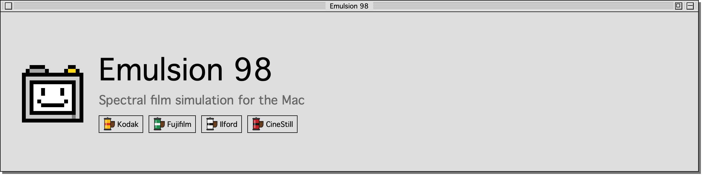
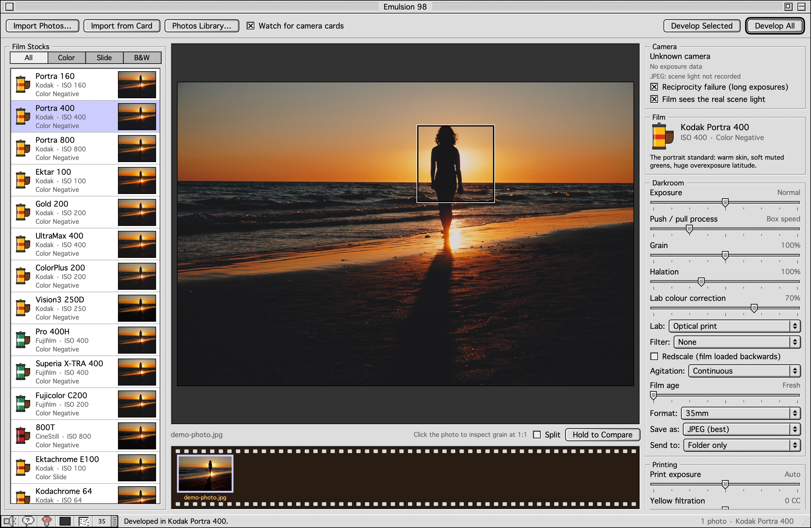
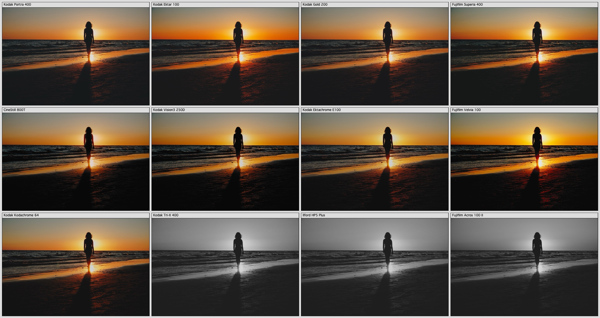
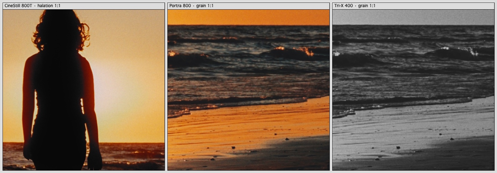
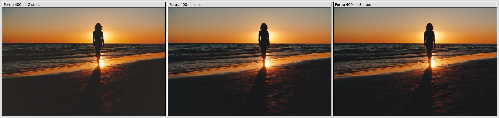
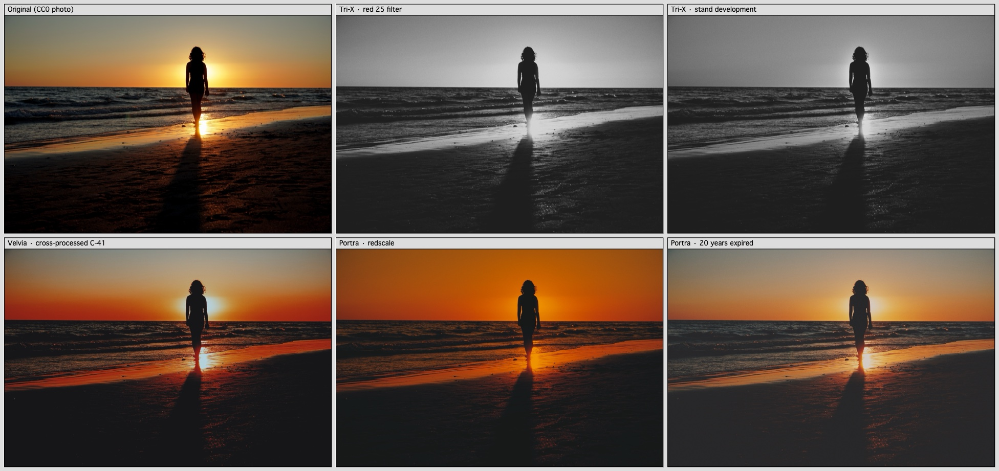
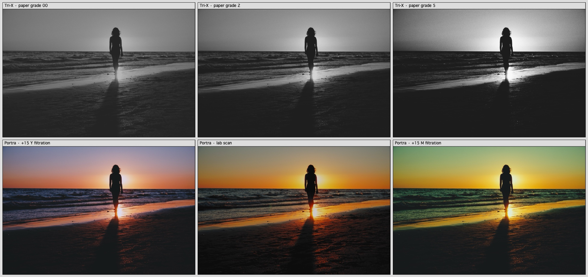
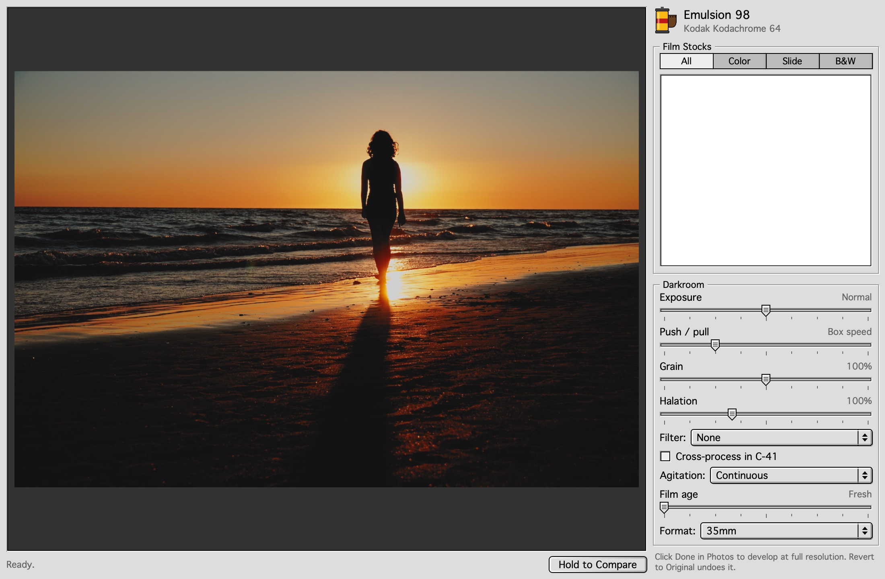
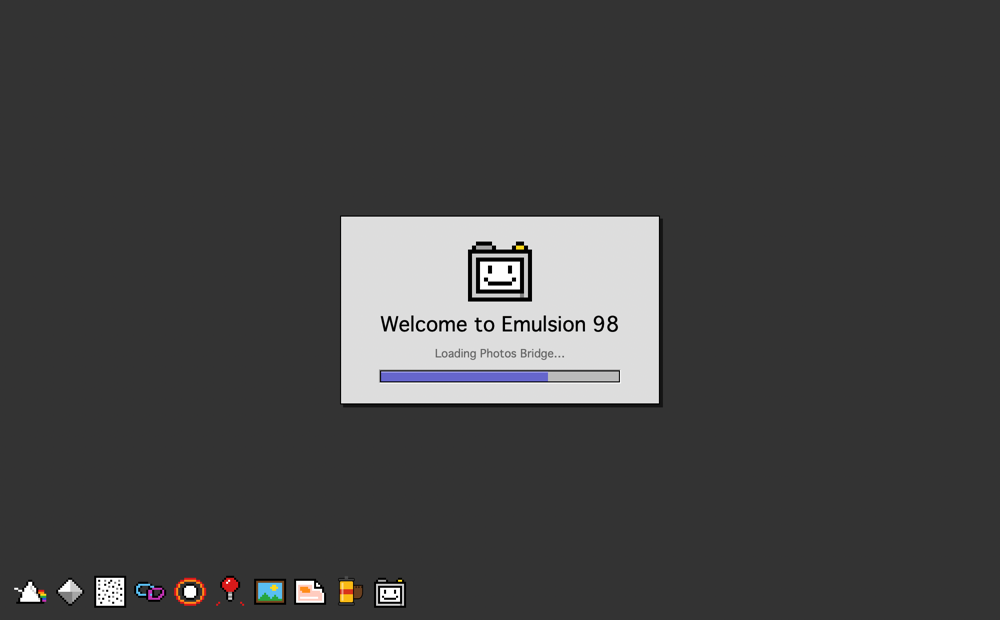
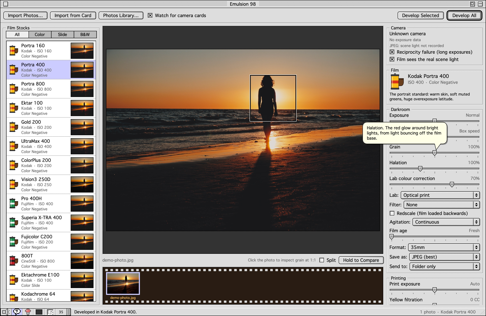

<p align="center">
  
</p>

<h1 align="center">Emulsion 98 · Film Simulation for Mac</h1>

<p align="center">
  <b>A physically based film emulation darkroom for macOS.</b><br>
  Develop RAW, JPEG and HEIC photos through spectral simulations of Kodak, Fujifilm, Ilford and CineStill film, with real film grain, halation, push processing, cross-processing and redscale. It runs in a hand-drawn late-90s Mac OS 8 "Platinum" interface and plugs into Apple Photos.
</p>

<p align="center">
  
  
  
  
  
</p>

<p align="center">
  <a href="#-read-me-first">Read Me</a> ·
  <a href="#-film-stocks">Film stocks</a> ·
  <a href="#-darkroom-techniques">Techniques</a> ·
  <a href="#-how-the-film-simulation-works">How it works</a> ·
  <a href="#-apple-photos">Apple Photos</a> ·
  <a href="#-installation">Install</a> ·
  <a href="#-faq">FAQ</a>
</p>

<p align="center">
  
</p>

---

## ▸ Read Me First

Most "film filters" are a colour lookup table and a grain overlay. **Emulsion 98 simulates the film itself.** Every pixel becomes a light spectrum, which is exposed onto each film layer's measured spectral sensitivity and developed through the stock's measured characteristic curves, couplers and grain statistics. Negatives are then printed on simulated paper under an enlarger lamp. The result reacts like film: overexposure, mixed light, tungsten bulbs, a red filter on Tri-X, a pushed roll of Portra 800 or a ten-year-old expired roll all behave the way they would on film.

- 🎞 **23 film stocks:** Kodak Portra 160 / 400 / 800, Ektar 100, Gold 200, UltraMax 400, ColorPlus 200, Vision3 250D, Ektachrome E100, Kodachrome 64, Tri-X 400, T-Max 100 · Fujifilm Pro 400H, Superia X-TRA 400, C200, Velvia 100, Provia 100F, Astia 100F, Acros 100 II · Ilford HP5 Plus, FP4 Plus, Delta 3200 · CineStill 800T
- 🔬 **Measured data, not presets:** 15 stocks and all 3 papers use digitised datasheet spectra and curves (see *Credits*).
- 🌫 **Real film grain** from crystal statistics of each layer's fast, medium and slow sub-emulsions, so underexposed negatives look grainy and overexposed ones look fine, as on real film.
- 🔴 **Halation**, emulsion scatter and DIR-coupler edge effects, with CineStill's red glow around highlights.
- 📷 **Camera-aware RAW pipeline**, tuned for the Panasonic Lumix LX5 and working with about 940 cameras through Apple's RAW engine. It reads the as-shot white balance, so daylight film really goes amber under tungsten.
- 🧪 **Darkroom techniques:** push/pull, lab scan or optical print, lens filters, cross-processing, redscale, stand development, expired film and reciprocity failure.
- 🖼 **Apple Photos integration:** browse and import from your library (RAW originals preferred), save to an album, or use the **Photos editing extension** inside Photos itself, non-destructively.
- 💾 **A genuine late-90s Mac experience:** WindowShade, Balloon Help, Control Strip, extensions parade, Darkroom Saver, Sad Camera. All artwork and sounds are original.

## ▸ Film Stocks

<p align="center">
  
</p>

| Type | Stocks |
|---|---|
| **Colour negative** | Kodak Portra 160 · Portra 400 · Portra 800 · Ektar 100 · Gold 200 · UltraMax 400 · ColorPlus 200 · Vision3 250D · Fujifilm Pro 400H · Superia X-TRA 400 · Fujicolor C200 · CineStill 800T |
| **Slide (reversal)** | Kodak Ektachrome E100 · Kodachrome 64 · Fujifilm Velvia 100 · Provia 100F · Astia 100F |
| **Black & white** | Kodak Tri-X 400 · T-Max 100 · Ilford HP5 Plus · FP4 Plus · Delta 3200 · Fujifilm Neopan Acros 100 II |

<p align="center">
  
</p>

<p align="center">
  
  <br><sub>Exposure latitude: Portra 400 at −2, 0 and +2 stops. The lab prints each one normally, so the thin negative shows coarse grain and muddy shadows, and the dense one stays clean.</sub>
</p>

## ▸ Darkroom Techniques

<p align="center">
  
</p>

| Technique | What is simulated |
|---|---|
| **Push / pull** | Rated speed change with longer or shorter development. Measured push +1 and +2 curves where they exist (Portra 800). |
| **Optical print vs lab scan** | RA-4 paper printing under a tungsten-halogen enlarger, or a minilab-style RGB scanner with per-channel inversion, scanner optics and the lab's unsharp mask. |
| **Darkroom printing** | Dichroic Y/M filtration in CC units, print exposure, and pre-flashing to hold highlight detail. |
| **Multigrade B&W paper** | Grades 00–5, set by the blue:green split of the enlarger light between a hard and a soft emulsion. Colour-head Y/M work on B&W too. |
| **Lens filters** | Yellow, orange, red, green and blue (Wratten 8–58), plus 85B, 80A, 81A and 82A, applied to the light *spectrum*, with through-the-lens metering. |
| **Cross-processing** | E-6 slide film in C-41: measured slide curves mirrored and printed without an orange mask. |
| **Redscale** | Film loaded backwards: light passes through the orange base and the layers in reverse order. |
| **Agitation** | Continuous, intermittent or stand development: developer exhaustion, edge effects, compensation and bromide drag. |
| **Expired film** | Per-layer speed loss, chemical fog and flatter contrast by storage (freezer to hot car), plus speed-dependent radiation fog. |
| **Reciprocity failure** | Schwarzschild law per layer, from the EXIF shutter speed. |
| **Scene light** | The film sees the real colour temperature from the RAW's white balance, and the lab corrects only part of it. |

<p align="center">
  
  <br><sub>Printing: Tri-X on variable-contrast paper at grades 00, 2 and 5 (top). Portra 400 with +15 Y and +15 M enlarger filtration, and as a lab scan (bottom).</sub>
</p>

## ▸ How the Film Simulation Works

A spectral, physically based model of shooting, developing and printing film (`Sources/FilmEngine`).

<details>
<summary><b>1 · Camera RAW → scene light</b></summary>

Apple's RAW engine decodes into wide-gamut linear Rec.2020 with no tone curve, no local tone mapping and no digital sharpening. Lens correction and highlight recovery are on, and noise reduction is tuned per camera and ISO. The decoder also reads the as-shot white balance, which is the colour of the scene light. Scene-linear OpenEXR is also accepted.
</details>

<details>
<summary><b>2 · Spectral reconstruction and exposure</b></summary>

- Each pixel becomes a smooth, physically valid reflectance spectrum (spectral primary decomposition after Mallett & Yuksel 2019, 380–780 nm in 5 nm steps). Three bounded basis spectra sum to a flat white and reproduce the sRGB primaries to about 1e-5 in XYZ. This avoids the hidden deep-red and UV metamers that film would record but the eye ignores.
- **Wide-gamut colours** (P3 phone photos, saturated RAW colours) use a 128×128 chromaticity grid holding the closest physically valid spectrum (a Dykstra projection onto non-negative spectra with exact CIE XYZ). It is continuous across the sRGB gamut boundary.
- **Scene light:** the CIE daylight series (from S0/S1/S2, which reproduce D65 to 0.03 %) at 4500 K and above, a blackbody for tungsten at 3500 K and below. Films are referenced to the light in their datasheets: D55 for daylight stocks, 3200 K for tungsten.
- The spectrum is integrated against each layer's measured spectral sensitivity, including Fujifilm's fourth, cyan-sensitive layer.
</details>

<details>
<summary><b>3 · Optics: scatter and halation</b></summary>

Emulsion scatter uses a long-tailed PSF (a 4-Gaussian fit of the Frieser MTF 1/(1+(f/fc)²)) per layer: the deep red layer is 1.25× softer and the top blue layer 0.8×. Halation is light reflected from the base back into the red layer. It is energy-conserving, clipped highlights act as light sources, and its strength follows each datasheet's antihalation rating. Vision3's remjet stops it; CineStill glows.
</details>

<details>
<summary><b>4 · Development: DIR couplers, curves, agitation, ageing</b></summary>

- **DIR couplers:** inhibitors diffuse 15–30 µm. Same-layer inhibition gives edge effects; interlayer inhibition gives colour saturation.
- **Characteristic curves:** measured datasheet curves, with measured push curves where available.
- **Reciprocity:** the Schwarzschild exponent per layer.
- **Developer exhaustion:** activity a(x) = 1 − s·(K ∗ D̄)(x), where K is diffusion plus a one-sided bromide-drag tail. *Stand* development also compensates large dense areas. Reversal film is handled through its first developer.
- **Expired film:**
  - Chemical ageing is scaled by storage (freezer ×0.08, fridge ×0.3, room ×1, hot ×2.5).
  - Per decade at room temperature: about 1 stop of speed loss (blue layer fastest), chemical fog (+0.05 / 0.07 / 0.12 D for the red / green / blue layers) and 6 % less contrast.
  - Radiation fog grows with film speed regardless of temperature.
</details>

<details>
<summary><b>5 · Grain from sub-emulsion crystal statistics</b></summary>

- Each layer's three measured sub-emulsions (fast, medium and slow) fill one after another as exposure rises.
- Their density fluctuation follows the Nutting / Siedentopf relation for a binomial fill plus dye-cloud placement: σ² ∝ a·Dmax·[p(1−p) + 0.05 p] / A.
- Crystal areas come from the measured speed separation (area ∝ speed^½). Each layer is calibrated to the datasheet RMS granularity at D = 1 through a 48 µm aperture.
- Each sub-emulsion also has its own dye-cloud size and binomial skew. Pixels smaller than a dye cloud saturate at the cloud size (Selwyn's law).
</details>

<details>
<summary><b>6 · Printing, scanning and viewing</b></summary>

- **Optical print:** a 3200 K tungsten-halogen enlarger behind a KG3 heat filter shines through the negative's dye spectra and orange mask onto the measured paper sensitivities (Kodak Portra Endura, Fujifilm Crystal Archive Type II, or Kodak 2383 for cine stocks). Printer lights are solved automatically, as a lab does.
- **Printer's controls:** dichroic filtration acts on the paper's log exposures (+Y removes blue light, so the print goes bluer), and print exposure is in stops. **Pre-flash** adds a uniform sub-threshold exposure (a fraction of the paper's mid-scale exposure) that lifts dense highlights out of the paper's toe, and the printer re-sets exposure so mid grey is unchanged.
- **Variable-contrast B&W paper:** a blue-only hard emulsion and a green-sensitised soft emulsion (which keeps its native blue sensitivity), exposed by the enlarger lamp through Ilford-style grade filters or colour-head Y/M. The spectrally computed blue share of the exposure maps to the ISO paper range (R ≈ 180 at grade 00 to ≈ 50 at grade 5). Grade 2 reproduces the classic graded print.
- **Lab scan:** narrow-band RGB LEDs (650 / 545 / 450 nm), per-channel inversion against a grey scale, a scanner tone curve and a colour boost. Then the scanner's optics (≈ 3.5 µm blur, a 4000 dpi-class MTF) and the fixed unsharp mask minilabs apply (9 µm radius, on log luminance so it adds no colour fringes), which gives scans their crisp, grain-forward look.
- **Viewing:** dyes are integrated under D50 (ISO 3664), or a ≈ 5400 K projector for 2383, and Bradford-adapted to the paper or base white. First-surface reflection and glare are included (0.4 % for glossy paper), which limits print blacks to a visual density of about 2.3–2.5.
</details>

<details>
<summary><b>7 · Calibration and accuracy</b></summary>

- **Measured stocks** get no colour calibration: their character comes entirely from the data.
- **Grey scale:** every stock holds a neutral grey ramp across about ±5 stops.
- **Fitted stocks** (Astia, ColorPlus, B&W) use a regularised layer-crosstalk matrix and scanner profile fitted to a ColorChecker plus each stock's documented character.
- **ColorChecker results:** mean hue difference 7–10° for the measured stocks (each film's own character, not error). Chroma is about 1.0× for Portra, 1.35× for Ektar and 1.55× for Velvia.
</details>

### Camera integration

| | Panasonic Lumix LX5 (dedicated profile) | Other cameras (≈ 940 RAW models) |
|---|---|---|
| Decoding | Apple's LX5 profile, RW2 lens-distortion correction, highlight recovery | Apple's profile for that camera, same settings |
| Noise reduction | Per-ISO table for the 1/1.63" CCD | From ISO × crop² (crop factor read from EXIF) |
| Sharpening | Off: film was never digitally sharpened | Off |
| Scene light | As-shot white balance | As-shot white balance |

## ▸ Apple Photos

<p align="center">
  
</p>

- **Photos Library…** (⇧⌘P): browse Library, Recently Added, RAW, Favorites and albums, and import originals. The RAW file is preferred, and iCloud originals are downloaded as needed.
- **Send to Photos:** save developed photos to an "Emulsion 98" album, or **apply the film as a non-destructive edit** of the original. *Revert to Original* undoes it.
- **Photos editing extension:** in Photos, choose **Edit ▸ ⋯ ▸ Emulsion 98** to develop any photo on film without leaving Photos. Edits are re-editable, and the app and the extension share the same edit data.
  - Enable it once under **⋯ ▸ More…** in Photos, or System Settings ▸ General ▸ Login Items & Extensions ▸ Photos Editing.
  - Photos hands extensions its own rendering of the image, not the RAW file. For the RAW pipeline, import into the app and use *Apply as edit*.

## ▸ About This Darkroom

<table>
<tr>
<td width="50%"></td>
<td width="50%"></td>
</tr>
</table>

It's a native SwiftUI app styled after 1998's Mac OS 8 Platinum appearance. Every control, icon and sound is original, drawn or synthesised at runtime.

- **Startup screen** with the Happy Camera, an extensions parade and a startup chord.
- **WindowShade** (double-click the title bar), **Balloon Help** (⇧⌘/) and the **Control Strip**.
- **Desktop patterns**, **safelight mode**, a **wristwatch cursor**, shutter sounds and the **Darkroom Saver** screen saver.
- A **bomb dialog** and a **Sad Camera** for errors, and an About box with a secret (click the camera).
- **Get Info** (⌘I), a split before/after view (⌘\\), and keyboard navigation (⌘← ⌘→ for photos, ⌘↑ ⌘↓ for films).

## ▸ Installation

**System requirements:** macOS 15 Sequoia or later on Apple silicon or Intel, plus the Xcode Command Line Tools (Swift 6). Xcode itself is not needed.

```bash
git clone https://github.com/oddnebula/emulsion-98.git
cd emulsion-98
./scripts/build_app.sh
open "dist/Emulsion 98.app"
```

The build script makes the app bundle, embeds and registers the Photos extension, and signs it ad hoc for your own Mac. Move the app to `/Applications` if you want to keep it.

**Using it:**
1. Import photos with ⌘O, by dragging them in, from a camera card, or from Photos.
2. Pick a film stock and adjust it in the Darkroom panel.
3. Click the photo for the 1:1 grain loupe.
4. Press ⌘E to develop at full resolution into `~/Pictures/Emulsion 98/Developed/`. EXIF and GPS data are kept.

### Command-line tool

```bash
swift build -c release
.build/release/emulsion-cli list --long                                # stocks, halation, granularity
.build/release/emulsion-cli develop photo.RW2 portra400 out/           # full-resolution develop
.build/release/emulsion-cli develop photo.RW2 trix400 out/ --filter red25 --agitation stand
.build/release/emulsion-cli develop photo.RW2 velvia50 out/ --xpro     # cross-process; also --redscale, --scan, --push 2, --age 15 --storage fridge
.build/release/emulsion-cli develop photo.RW2 hp5 out/ --grade 4 --preflash 0.5           # multigrade paper; also --cc-y 10 --cc-m 5 --print-ev 0.2
.build/release/emulsion-cli sheet photo.RW2 sheet.jpg                  # contact sheet of every stock
.build/release/emulsion-cli crop photo.RW2 cinestill800t c.jpg         # 1:1 crop
.build/release/emulsion-cli diag portra400                             # ColorChecker accuracy
.build/release/emulsion-cli granularity portra400                      # RMS granularity vs density
.build/release/emulsion-cli mtf velvia50                               # system MTF, datasheet-style
```

`scripts/make_readme_images.sh` regenerates every comparison image in this README.

## ▸ FAQ

**How do I make digital photos look like real film on a Mac?**
Import your photos, ideally RAW files, into Emulsion 98 and choose a film stock. Instead of applying a filter, it simulates exposing, developing and printing that film from measured datasheet data, which is why highlights, skin tones, mixed light and grain behave like film.

**Is this a Kodak Portra / Fuji / Tri-X preset or LUT?**
No. There are no LUTs of finished looks. Each stock is a spectral model of the emulsion (layer sensitivities, dye spectra, characteristic curves, sub-emulsion grain) and of the paper it is printed on, so the same stock looks different in daylight, under tungsten, pushed, or overexposed.

**Does it work inside Apple Photos?**
Yes. The bundled Photos editing extension adds Emulsion 98 to **Edit ▸ ⋯** in Photos, and the app can import from and save back to your library.

**Which cameras are supported?**
Any camera Apple's RAW engine supports (about 940 models), plus JPEG, HEIC, PNG, TIFF and OpenEXR files. The Panasonic Lumix LX5 has a dedicated profile.

**Can it do cross-processing, redscale, expired film or stand development?**
Yes. Each is simulated physically from the film data, not painted on as a colour effect.

## ▸ Credits & Licence

- **Code:** MIT licence (see [`LICENSE`](LICENSE)).
- **Measured film data:** [spektrafilm](https://github.com/andreavolpato/spektrafilm) profiles by Andrea Volpato, licensed **CC BY-SA 4.0**. Copies are in `Data/spektrafilm/` with the licence and a changelog of the changes made. `Sources/FilmEngine/MeasuredData.swift` is generated from them by `scripts/convert_spektrafilm.py` and is itself CC BY-SA 4.0. Photos you develop are not affected by this licence.
- **Demo photo:** beach at sunset by Nilo Velez, [WordPress.org Photos](https://wordpress.org/photos/photo/426884abe5/), **CC0** (public domain), metadata stripped. Every film rendering in this README is Emulsion 98's own output.
- **Method references:** Mallett & Yuksel 2019 (spectral primary decomposition); CIE 15 (daylight, colorimetry); ISO 3664 (viewing); the Frieser, Nutting, Siedentopf and Selwyn models of emulsion MTF and granularity.

Not affiliated with Kodak, Kodak Alaris, Fujifilm, Ilford, Harman, CineStill or Apple. Film stock names are trademarks of their owners and identify the look being emulated.

<p align="center"><sub>film simulation · film emulation · analog film look · film grain · halation · Kodak Portra · Fujifilm Velvia · Kodak Tri-X · CineStill 800T · cross-processing · redscale · expired film · RAW photo editor for Mac · Apple Photos extension · SwiftUI · color science · spectral rendering</sub></p>
